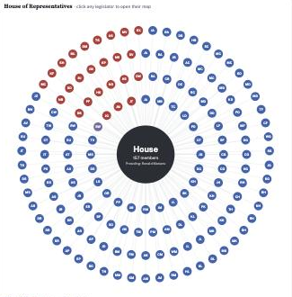
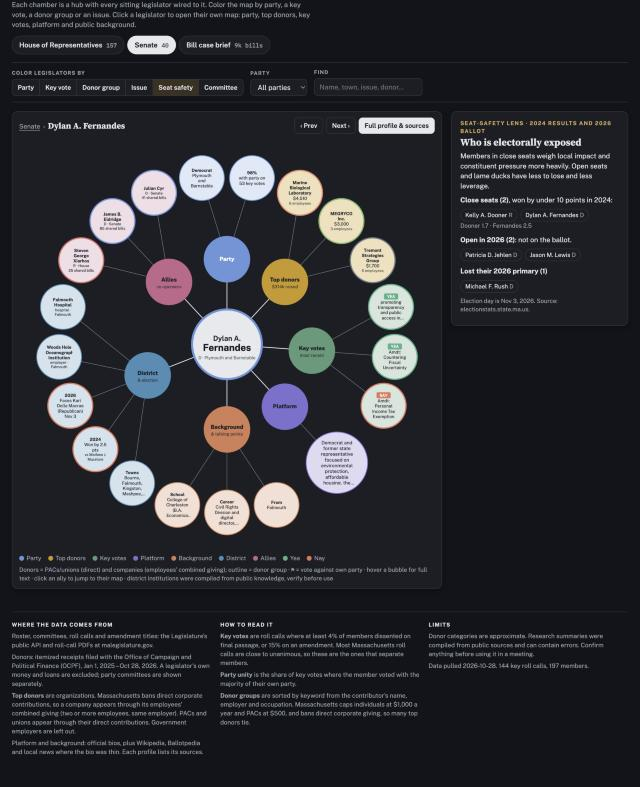
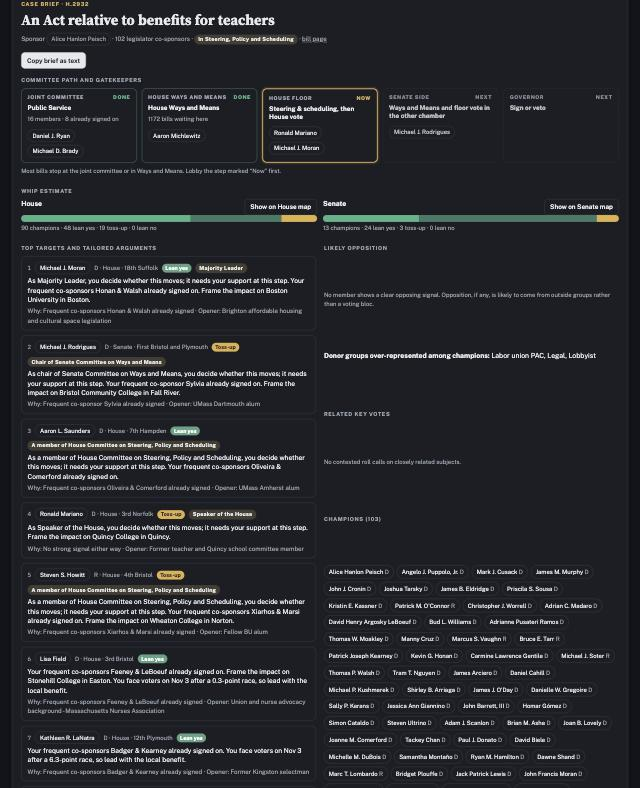

# Beacon Hill Influence Map

An interactive map of every sitting member of the Massachusetts Legislature (194th General Court, 2025–2026), built as a lobbying case-study tool. It is meant to answer three questions before a meeting: **who will support a bill, why they would, and what interest groups and personal background shape that decision.**

> The source code and data pipeline are in a private repository. This page describes the project. A live demo is available on request.

## What it shows

There are two radial maps, one for the **House (157 members)** and one for the **Senate (40 members)**. The chamber sits at the hub with every legislator wired to it. Clicking a legislator opens their own map: they sit at the hub, wired to five color-coded category bubbles, each with its detail bubbles around it.

| Bubble | Contents |
|---|---|
| **Party** | Party, district, leadership post, and a *party unity* score (how often they vote with their own party on contested votes) |
| **Top donors** | Top three organizations since January 2025: PACs and unions by direct giving, and companies by their employees' combined giving (Massachusetts bans direct corporate contributions). Each is tagged by group, such as labor union, lobbying firm, real estate or health care |
| **Recent key votes** | Their most recent contested roll calls, with votes against their own party flagged |
| **Platform** | A one-sentence summary of their priorities |
| **Background & talking points** | Hometown, career, education, military service, and conversation openers drawn from their public record |

Each legislator's map also includes:

- **District:** the towns, their 2024 winning margin, their status on the Nov 3, 2026 ballot, and notable local hospitals, colleges and employers.
- **Allies:** the colleagues they co-sponsor bills with most often. Persuading one member often brings their allies along.

## Bill case brief

Search any of the ~9,000 bills filed this session to get a one-page brief:

- **Committee path and gatekeepers.** Where the bill sits now (joint committee, Ways and Means, floor, the other chamber, Governor), parsed from the official bill history, with the chairs and leaders who control each step.
- **Whip estimate.** Every legislator is scored Champion, Lean yes, Toss-up or Lean no from co-sponsorship, similar bills they've signed, co-sponsor networks, stated priorities, party and related roll calls.
- **Top targets with tailored arguments.** Persuadable members ranked by leverage (gatekeepers first), each with a suggested argument built from their record, district and electoral situation, plus a conversation opener.
- **Likely opposition** and the donor groups over-represented among opponents versus champions.
- A **copy-as-text** version for memos.

## Lenses for case-study work

- **Key vote.** Pick any of 144 contested roll calls. The chamber diagram recolors Yea/Nay, and the side panel shows the party split and lists every member who broke with their party, who are the persuadable middle.
- **Donor group.** Pick an interest (for example labor unions, real estate, health care, or lobbyists) to see which members receive the most from it. These are the natural first calls for a coalition.
- **Issue.** See which members list an issue as a priority, so you can find sponsors and champions.
- **Party.** Shows the balance of power and the members least likely to vote the party line.
- **Seat safety.** Close 2024 races, open seats and members who lost their 2026 primary.
- **Committee.** Highlights a committee's chairs and members, the gatekeepers for bills in its area.

From any legislator's map, a full profile shows every key vote, a breakdown of donor groups, top PACs, committees, and links to sources.

## Data

All data is public:

- **Malegislature.gov API and roll-call records.** The roster, committees, about 9,000 bill histories, and **512 roll calls**, parsed from the official PDFs and matched to members. Amendment titles and sponsors come from the API. "Key votes" are the 144 roll calls with real dissent (most Massachusetts roll calls are close to unanimous).
- **Office of Campaign and Political Finance (OCPF).** About **83,000 itemized receipts** filed between January 2025 and October 2026. Contributors are grouped by PAC name, employer, and occupation.
- **electionstats.state.ma.us.** 2024 general results, 2026 primaries and the towns in each district.
- **Official biographies**, supplemented with Wikipedia, Ballotpedia, and local news for platform summaries and background. Each profile cites its sources.

## Method notes

- Massachusetts caps individual gifts at $1,000 a year and PAC gifts at $500, and bans direct corporate contributions. Because of this, aggregated donor *groups* say more than any single donor.
- Party unity is the share of a member's key votes cast with their party's majority.
- Donor categories are assigned by keyword and are approximate. The background research is a starting point, and every fact should be checked before it is used in a meeting.

## Built with

Python (data collection, PDF parsing, record matching and classification), and a single-file HTML/CSS/JavaScript front end with no framework.
